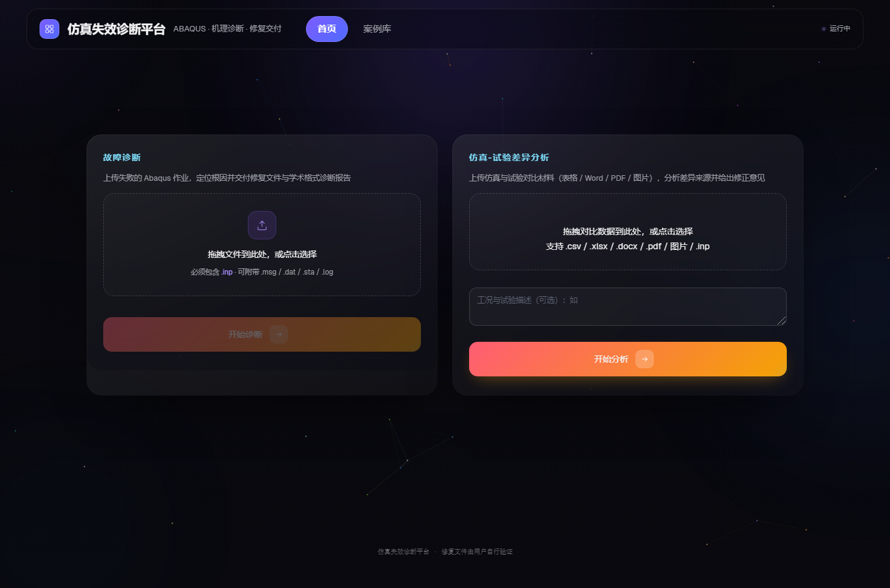
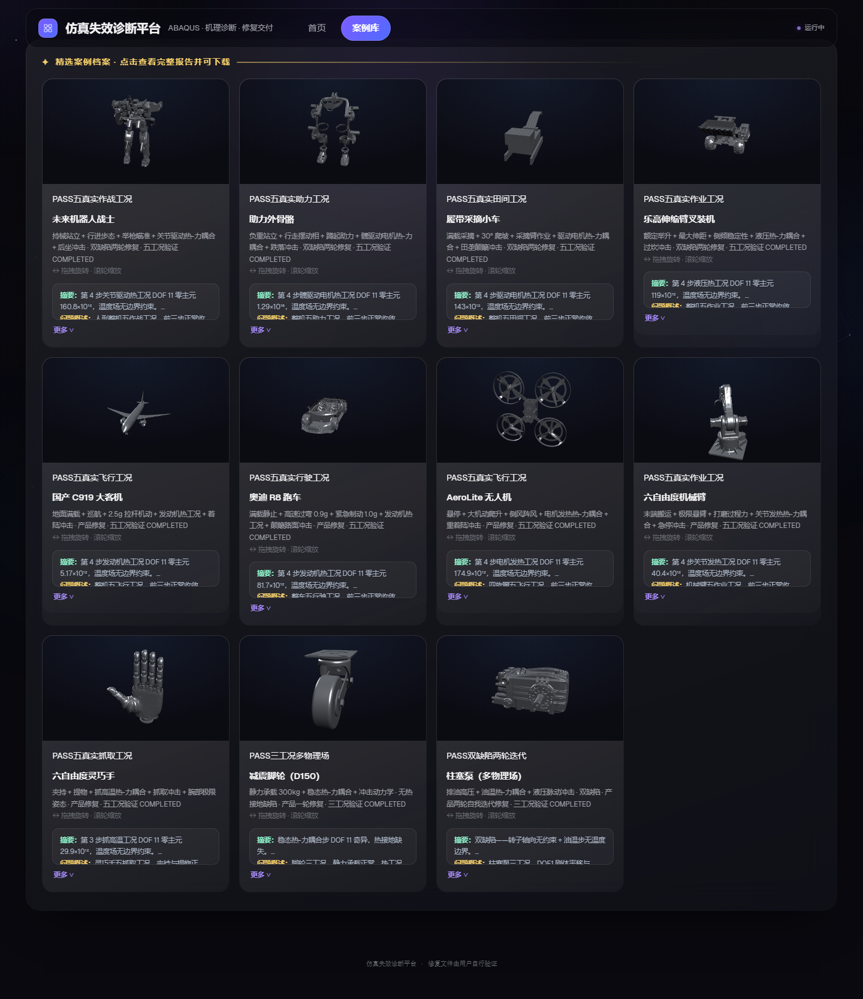
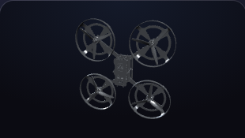
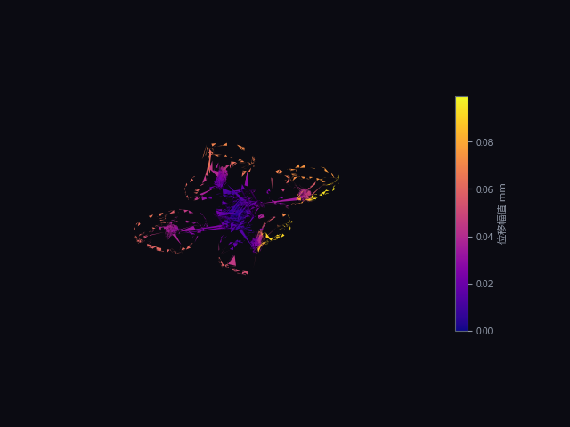
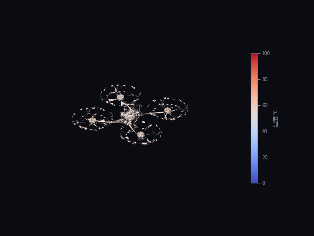
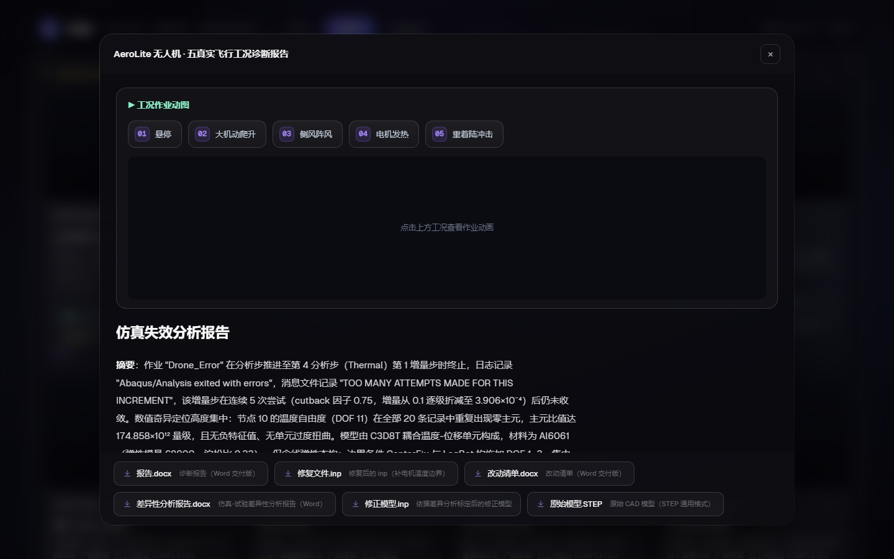
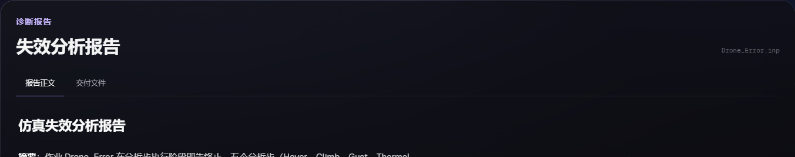
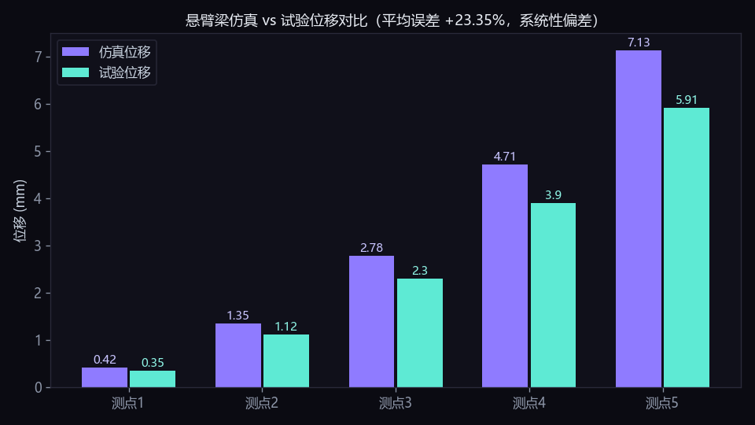

# 解蹇 · JieJian —— FEA 错误分析 · 物理 AI 高质量数据底座

**Physics AI High-Quality Data · FEA Error Analysis** — turn failed simulations into verified, labeled training data.

<div align="center">
  <a href="https://github.com/chanyanxuan/jiejian-physai-data"></a>
  <a href="https://creativecommons.org/licenses/by-nc/4.0/"></a>
  <a href="http://8.134.127.252"></a>
  <a href="https://github.com/chanyanxuan/jiejian-physai-data"></a>
</div>

<div align="center">
  
</div>

### 物理 AI 的高质量数据底座

> 我们不产生物理 AI 的数据——**我们把低质量、无用的数据，变成高质量、有价值的数据。**

**Keywords**: `FEA` `CAE` `Abaqus` `simulation` `error-analysis` `finite-element` `physics-ai` `sim-to-real` `dataset` `diagnosis` `repair` `verification` `digital-twin` `engineering-data` `LLM`

**在线试用**：[http://8.134.127.252](http://8.134.127.252)



---

## 名字的由来：水山蹇（䷦ · 第 39 卦）

蹇卦，下艮（山）上坎（水）——**山上有水，险阻在前**。卦义是：前路艰难，唯有知难而进、反身修德，方能涉险而济。

这正是我们面对的世界：

- **蹇**，是仿真工程师的日常——求解器报错、结果与试验对不上、数据不可信；
- **蹇**，也是物理 AI 时代的困境——数据海量，但能训模型的高质量数据稀缺；
- **解蹇**，即排解艰难——把报错的模型修好，把不可信的数据变成可信资产。谐音"**简洁**"：报告简洁、结论简洁、信任简洁。

产品图标即为蹇卦六爻（阴 · 阳 · 阴 · 阳 · 阴 · 阴），寓意"险阻在前，我们负责解"。

我们的信条：**不盲从方案，不回避风险，仿真经得起实测。**

---

## 我们做什么

物理 AI（诊断 Agent、工程大模型、AI 原生仿真）最缺的不是更多数据，而是**带验证、带标签的可信数据**。解蹇的核心能力是：**给每一份有限元数据做"体检、诊断、修复、验证"**，让它们从"低质量或无用"变成"高质量、可直接训练"。

```
低质量 / 无用的数据               解蹇                      高质量数据资产
─────────────────              ────────                 ─────────────────
报错的仿真文件（inp+日志）  →  错误分析 + 修复  →  错误-诊断-修复-验证闭环轨迹
对不上试验的仿真结果       →  差异量化 + 归因  →  sim-to-real 校准数据 + 修正模型
没人敢签字的分析报告       →  机理级报告      →  带机理标签的可检索知识
```

## 五大功能

### ① 仿真文件错误分析（机理级）
输入报错的有限元模型，输出**讲透两层机理**的诊断与修复：

- **程序机理**：求解器为什么失败——零主元、过约束、温度自由度奇异、表面定义丢失、单位制不一致等 12+ 类失效判据；
- **物理机理**：背后的物理原因——约束不足引发的刚体模态、温度场刚体平移零能模态、应力奇异等，多角度论证（受力 / 变形 / 应力 / 本构 / 能量 / 现象）；
- **交付**：**修改后的模型文件** + 改动清单 + 学术格式诊断报告（Word）。

### ② 仿真-试验差异性分析
仿真结果与实测对不上？自动量化每个测点的误差、分类差异模式（系统偏差 / 幅值 / 形状 / 局部异常），从物理机理与程序机理追溯误差来源，**给出修正后的模型文件**。

### ③ 有限元结果直读与解析
直接读取 Abaqus 结果文件（odb 场输出 / rpt / dat 报告表），自动提取位移、应力、温度等场数据并结构化——用户不必手工誊抄仿真值。

### ④ 高质量数据底座
每次分析都是一次数据生产：产出**带求解验证、机理标签、用户反馈**的错误-诊断-修复-验证闭环数据（见 [schema](schema/data_schema.md) 与 [质量体系](docs/quality.md)）。这些是训练下一代物理 AI 的黄金数据。

### ⑤ 案例库与知识沉淀
内置多物理场案例库（机械臂、无人机、外骨骼、汽车、客机等 11 个案例），支持三维模型查看与求解动画；内置 2.3 万条官方手册知识块检索。



## 产品怎么用：两个案例详解

### 案例一 · 报错分析：四旋翼无人机（热-力耦合失效）

**📥 给的是什么**：一份在求解中报错的 Abaqus 作业——`Drone_Error.inp`（全模型 C3D8T 耦合温度-位移单元，铝合金 Al6061，5 个分析步：Hover → Climb → Gust → Thermal → Landing）+ 报错日志（`.msg`）。这是仿真工程师手里最普通不过的"失败现场"。

**🖱 怎么用**：打开网页 → 把报错文件拖进左侧卡片 → 点"开始诊断" → 等 30 秒 ~ 3 分钟。全程无需安装任何软件。

**📤 输出的是什么**：
1. **机理级诊断报告**（Word，五段学术格式）——讲透两层机理：
   - *程序机理*：模型全部采用 C3D8T 单元（激活温度自由度 DOF 11），但 5 个分析步均未施加温度边界 → 节点 10 处 DOF 11 出现量级 10¹² 的零主元；
   - *物理机理*：温度场存在刚体平移零能模态——恒定温度平移不改变任何温度梯度与热流，与结构刚体模态同构；
2. **修改后的模型文件**（修复版 inp）：在耦合分析步内补充温度边界、后续步重置机械边界；
3. **改动清单**：改了什么、为什么改，逐条可查。

**✅ 输出后的效果**：修复后的模型重新提交求解器验证——**5 个分析步全部完成（COMPLETED）**。从"算不出来"到"算完"，闭环可验证。

**🔧 SolidWorks 模型如何**：案例的三维几何来自公开产品模型（STEP/SOLIDWORKS 格式），产品支持模型查看与检查——前端可拖拽旋转、缩放查看三维模型，并可查看各工况的求解动画（位移 / 温度场着色）。上传的模型文件与求解结果全程留存，作为数据底座资产归档。

<div align="center">
  
  
  
</div>
<p align="center"><sub>无人机案例：产品内三维模型（左）· 悬停工况位移幅值云图（中）· 电机发热工况温度场云图（右）</sub></p>

<div align="center">
  
</div>
<p align="center"><sub>案例库界面：无人机案例详情——五工况求解动画与六件套交付文件下载</sub></p>

<div align="center">
  
</div>
<p align="center"><sub>诊断完成后的报告界面：机理级报告正文 + 交付文件（修复后的模型文件 / 改动清单）下载</sub></p>

### 案例二 · 仿真-试验差异分析：悬臂梁对标

**📥 给的是什么**：仿真侧（模型 inp + 结果 odb）+ 试验侧（一张两列表格：测点节点号、试验位移值）+ 一句工况描述。**仿真值不需要手工誊抄**——程序自己从结果文件里读。

**🖱 怎么用**：把仿真文件和试验数据一起拖进右侧卡片 → 填一句描述 → 点"开始分析" → 约 1 分钟出报告。

**📤 输出的是什么**：**差异性分析报告**——逐测点误差统计表、差异模式分类（系统性偏差）、物理机理与程序机理的误差归因、编号化改进建议；**修正后的模型文件**（按误差标定弹性模量的修正版 inp）。

**✅ 输出后的效果**：实测样例中，程序自动从 odb 读出 6 个测点仿真值，与试验值对比得平均误差 +23.35%、同向偏差 100%，判定为系统性偏差并给出修正模型——把"仿真和实测对不上"从一个感觉问题，变成可量化、可归因、可修正的工程问题。

<div align="center">
  
</div>
<p align="center"><sub>悬臂梁案例：仿真 vs 试验位移逐测点对比（程序自动读取仿真值，确定性量化差异）</sub></p>

<div align="center">
  
</div>
<p align="center"><sub>差异性分析报告界面：逐测点误差统计 + 差异模式分类 + 机理归因 + 修正模型下载</sub></p>

> 输入支持：`.inp` / `.msg` / `.dat` / `.sta` / `.log` / `.odb` / `.rpt` / 表格 / Word / PDF / 图片 / 自然语言描述。
> 完整样例数据包见 [samples/drone_thermal_error](samples/drone_thermal_error)。

## 效果（数据说话）

| 指标 | 结果 |
| --- | --- |
| 失效案例基准回归 | **17 / 17 命中，漏报误报双零** |
| 判案速度 | 秒级（确定性规则引擎） |
| 报告生成 | 30 秒 ~ 3 分钟（学术格式 Word） |
| 修复验证 | 修复后重新提交求解验证通过 |
| 报告可信度 | 一致性校验 + 基准回归双闸门 |

## 原理（概览）

```
判案层（确定性规则引擎）→ 判定缺陷与机理（规则当尺）
        ↓
白名单干预 → 自动修复 → 重新求解验证（闭环）
        ↓
大模型撰写机理报告（LLM 当笔，只论证判案事实，不编数据）
        ↓
一致性校验 + 基准回归 → 出厂
```

核心实现（判案规则、修复库、知识库、缺陷注入器）为商业机密，本仓库开放的是**数据与结果**。

## 快速开始（3 步，1 分钟上手）

```
① 打开 http://8.134.127.252 → 输入邀请码（JIEJIAN-001 / 002 / 003）
② 左侧拖入报错的仿真文件（.inp + .msg）→ 点"开始诊断"
③ 约 1 分钟拿到：机理级报告 + 修复后的模型文件 + 改动清单
```

想体验"仿真 vs 试验对标"？右侧卡片拖入仿真文件 + 试验数据表 + 一句描述即可。

## 免费试用

产品正在**试用阶段**。邀请码（每个码限 20 次分析，用完即止）：

```
JIEJIAN-001   JIEJIAN-002   JIEJIAN-003
```

访问 [http://8.134.127.252](http://8.134.127.252)，输入邀请码即可开始。

## 发展路线图

| 阶段 | 内容 | 状态 |
| --- | --- | --- |
| **现在** | 两大功能上线内测：报错分析（诊断+修复+验证闭环）、仿真-试验差异分析；17/17 基准回归 | ✅ 运行中 |
| **近期** | 错误案例库扩充至百级；缺陷注入器批量生产合成错误数据；全自动进化（案例→规则→基准闸门） | 🚧 开发中 |
| **中期** | 万级"错误-诊断-修复-验证"轨迹数据底座；数据 API 与授权分级；企业内网部署版 | 📋 规划中 |
| **愿景** | 成为物理 AI 时代的**高质量仿真数据基础设施**——每一份失败仿真都变成训练资产 | 🎯 |

## 我们在融资

解蹇目前处于试用阶段。**我们需要资金做得更好**：扩充错误案例库、扩展缺陷覆盖、建立万级数据底座、支撑物理 AI 的数据需求。

- 投资合作 / 数据授权 / 企业内网部署：**微信 CYX241**
- 邮箱：achenyanxuan@163.com
- GitHub Issues 提交反馈：本仓库 Issues 区

---

⭐ **如果这个项目对你有用，请点个 Star** —— 你的每一次 Star，都在帮物理 AI 时代的数据基础设施多一份关注。

*山上有水，险阻在前。我们不回避险阻——我们把它变成资产。*
